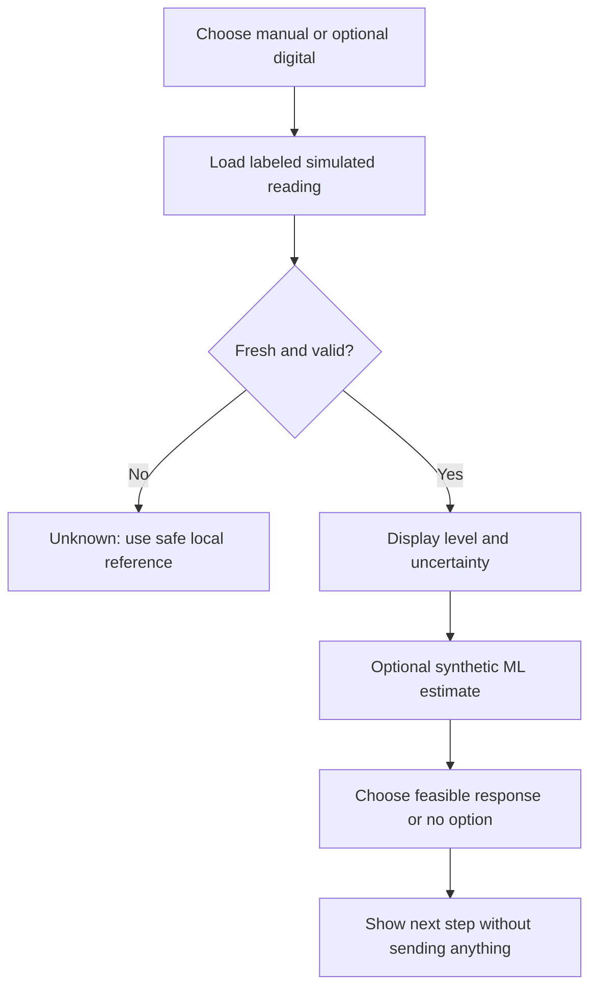
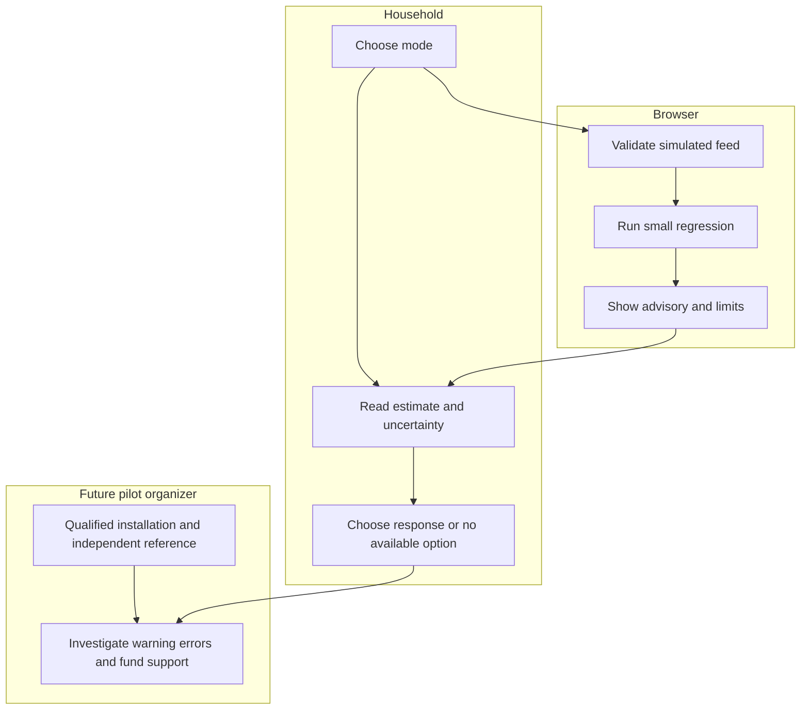

# Agua a la Vista
Fernanda Espinosa | Week 11 Business Bending | Packet before implementation

## Problem and exact user
Adults managing stored water in Mexico City homes with intermittent supply may spend time checking a tank yet still lack a feasible response. This slice tests a level-to-response interaction, not water access, potability, prevented shortages or market demand. Renters and shared-tank users must not be assigned individual blame.

## Success before the module closes
A live Spanish demonstration lets a user compare manual readings with optional digital alerts, see uncertainty and stale-data states, select a feasible response or explicitly report no available action, inspect an ML estimate, and calculate full illustrative costs. All feeds, training data and scenarios are synthetic. No household pilot is claimed.

## Image-generated mockup
An image-generation request was launched before implementation. The resulting concept will be attached to the PDF; it is a design reference, not a screenshot or operational evidence.

## Flow

## Actor lanes

## Benchmark
Phyn is our strongest researched benchmark for connected household monitoring, not a proven world ranking or a direct tank-level equivalent. Its installation guidance requires compatible connections, power and Wi-Fi (https://phyn.com/pages/swa-installation). Our slice localizes around intermittent storage, a manual-first comparison, optional digital information, visible uncertainty and a feasible-response gate. Isla Urbana supplies a local reference for installation and ongoing support (https://islaurbana.mx/servicios/), not validation of this product.

## Long view
In three years this could become a safely installed, locally readable household tool supported by a funded maintenance service. Optional alerts would remain only where comparative evidence shows useful action or less checking burden. Expansion would require verified full costs, a committed payer and reliable safeguards against surveillance.

## Scope cut
No hardware installation, real sensors, water delivery, payment collection, supplier marketplace, potability checks, shutoff, landlord dashboard, tracking, household identity, default history or field reliability claim. No public health or service availability promises. No claim that the proposed team synthesis was confirmed in a meeting.

## Architecture and Dragon Stack
| Layer | Implementation | Limit |
|---|---|---|
| IoT/sensing | Three labeled synthetic feeds plus manual entry | No hardware measurement |
| ML | Browser ordinary least squares trained on selected synthetic hourly level series | Actual fitted model; not field-trained or a reliable forecast |
| Third layer | Cost and contribution logic with manual/digital incremental costs | Illustrations, not supplier quotes or willingness to pay |
| UI | Static HTML/CSS/JS; memory only | Refresh clears session; no database |
| Hosting | Sites static deployment | Owner-private by default; evaluator access still needs verification |

## Security floor before build
No API keys or external data calls. No personal data stored or requested, so database auth/RLS are not applicable; this is an architecture choice, not a passed auth test. Validate finite numbers, ranges, required selections and lengths. Only invented labeled scenarios. No data sales, sharing, remote controls or default landlord view. Session records disappear on refresh; clear button withdraws session input immediately. Never climb roofs; any real pilot needs qualified installation and an independent reference.

## Blueprint acceptance
1. Show no-action path; never claim more water, money or safety.
2. State safe access and installer rule; missed critical warning pauses future pilot.
3. Manual information without registration/subscription; digital optional and removable.
4. No household histories, identity, sales, shutoff, enforcement or sharing.
5. Uncertainty always shown; stale/invalid data cannot produce reassuring status. Insufficient events remain inconclusive.
6. Full cost includes installation, support, training, recurring digital cost and overhead; no scale/payer claim.

## Test plan and evidence rules
Mechanical: boundary 0/100; invalid/empty/NaN input; fresh vs stale vs missing; optional alert toggle; no-action response; regression known slope and increasing/flat series; cost zero/negative/decimal cases; clear reset; mobile layout and keyboard controls. Record an observed failure, fix it, deploy again, then rerun affected checks. Do not manufacture a bug or backdate outcomes.
Persona: fresh-context synthetic persona review of actual ordered screens, clearly a simulation. Log hesitations and fix the worst observed problem. No real user validation claim. Six-household study remains proposed: two-week baseline plus two weeks each condition, randomized 3/3, supply confounders recorded. Stop unsafe/privacy incidents; pause missed critical warnings; reject digital without useful action/time benefit or affordable support.

## Commit and deployment plan
1 Packet before code. 2 ML and cost domain logic. 3 Accessible Spanish interface. 4 Mechanical tests and first deploy. 5 Evidence-based correction and second deploy. Update DECISIONS.md at session close and push.
